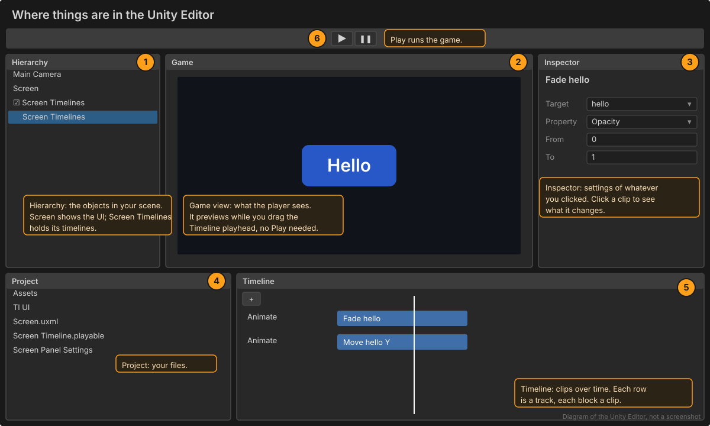
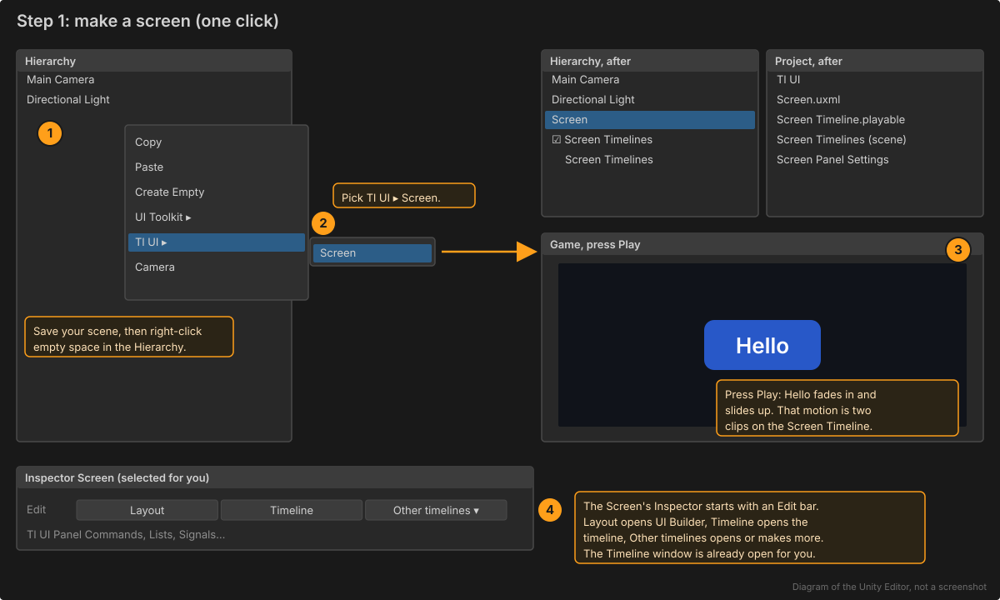
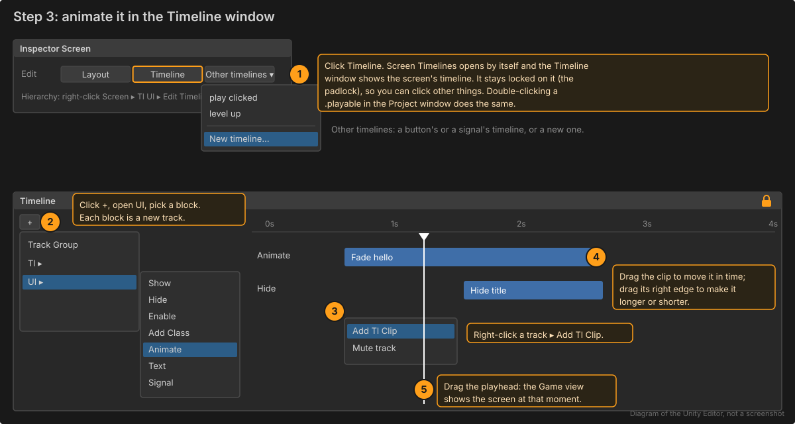
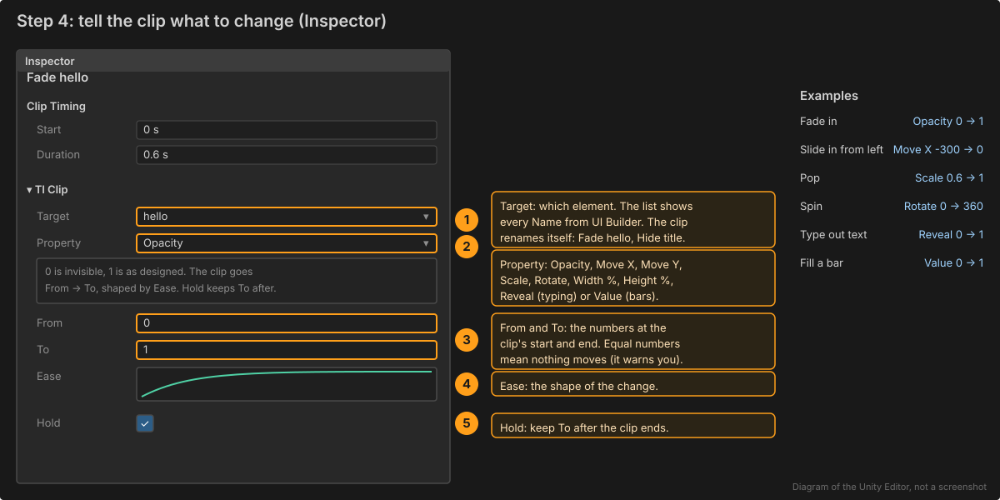
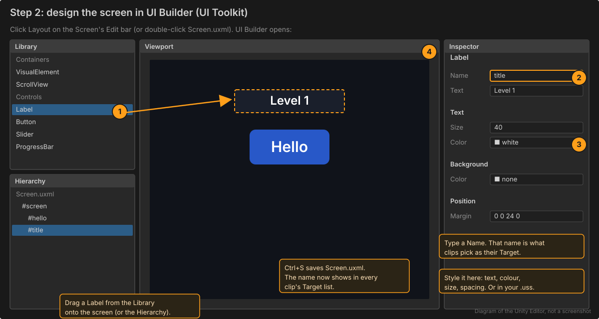
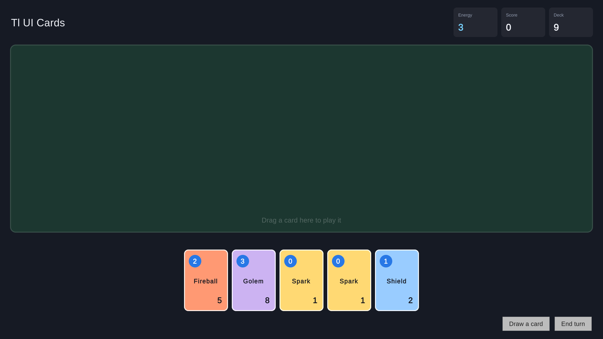
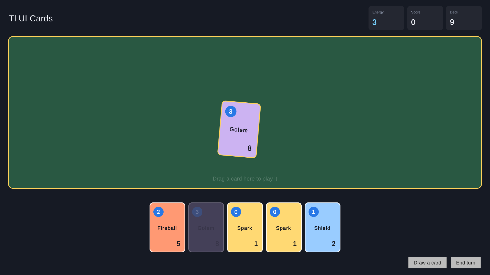
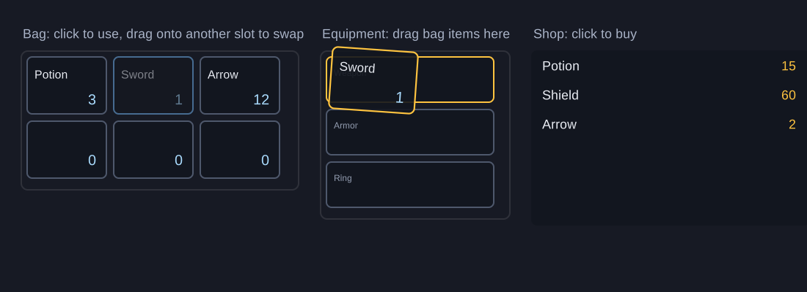
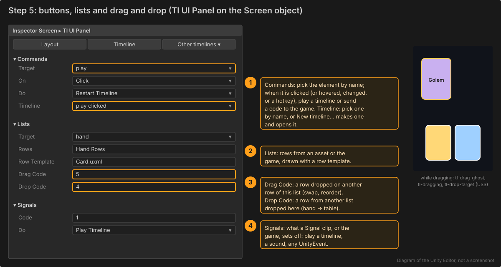

# Tl Unity UI

UI Toolkit screens driven by [Tl](https://github.com/IAFahim/tl) timelines and Unity ECS. Built for Unity 7000.0.0a20.

You make the screen the usual UI Toolkit way, with UXML, USS and UI Builder. Then three things drive it:

- **Timelines move the screen.** Show, hide, add a class, animate a value or type out text, all from clips in Unity's Timeline window.
- **Game data shows on screen.** A Burst system writes a plain ECS struct, and UI Toolkit bindings display it. Nothing is allocated per frame.
- **Input goes back to the game.** Clicks, slider changes and hotkeys become small integer codes that your Burst systems read.

Game code never calls the UI and never holds a reference to it. Game code writes data and codes, and the UI reads them.

## Designers: start here (no code)

**Visual guide, with a picture of every step and day-to-day recipes: [docs/DESIGNER-GUIDE.md](docs/DESIGNER-GUIDE.md).**



### 1. Your first screen, in one click

1. Save your scene.
2. In the **Hierarchy** (the list of objects, top left), right-click on empty space and pick **Tl UI > Screen**.
3. Press **Play** (top middle). A blue **Hello** fades in and slides up.



That's the whole loop. The rest of this section shows where that motion lives and how to change it.

### 2. Find the motion: the Timeline window

When you made the screen, the **Timeline** window opened at the bottom. If you closed it, or come back later:
1. Open **Window > Sequencing > Timeline**.
2. In the Hierarchy, tick the box next to **Screen Timelines**. That opens it for editing.
3. Expand it with the small arrow, and click the **Screen Timelines** object inside.

Always open the timeline this way, from its object, not by double-clicking the `.playable` file. Only then can the Inspector offer element names and the Game view preview while you scrub.

Each row in the Timeline is a **track**, and each block on a track is a **clip**. A clip changes something on the screen from where it starts until where it ends. The starter has two clips:
- **Fade hello**
- **Move hello Y**

Drag the white playhead (the vertical line) left and right. The Game view shows the screen at that moment, without pressing Play.



### 3. Read a clip: the Inspector

Click **Fade hello**. The **Inspector** (right side) shows, under **Tl Clip**:



| Field | What it means | Fade hello |
|---|---|---|
| **Target** | which element on the screen changes. Pick it from the list; it shows every element you gave a **Name** in UI Builder | hello |
| **Property** | what changes: Opacity, Move X, Move Y, Scale, Rotate, Width Percent, Height Percent, Reveal (typing) or Value (sliders, bars). The grey box under it says what the numbers mean | Opacity |
| **From** | the value when the clip starts | 0 (invisible) |
| **To** | the value when the clip ends | 1 (as designed) |
| **Ease** | the shape of the change, from From at the left to To at the right | fast, then slow |
| **Hold** | ticked: keep To after the clip ends. Unticked: go back to how the UXML looks | ticked |

Try it: set **To** to 0.3, then drag the playhead. Hello only gets faint. If From and To are the same, the Inspector tells you that nothing moves.

Change **timing** by dragging the clip left or right, or by dragging its right edge to make it longer or shorter.

### 4. Add a block

1. In the Timeline window, click **+** (top left of the track list) and open **UI**. Every block is there:

| Block | What it does while the clip is on |
|---|---|
| **Show** | shows the target, even if the UXML hides it |
| **Hide** | hides the target. **Keep Space** hides it but leaves its gap |
| **Enable** / **Disable** | makes a button or field usable, or greys it out |
| **Add Class** / **Remove Class** | adds or removes a USS class, so your stylesheet decides the look (glow, red, bigger) |
| **Attach** | puts a small UXML template inside the target, like a badge |
| **Animate** | moves one property from From to To (see the table above) |
| **Text** | swaps the target's text for another text |
| **Signal** | fires once at the clip's start: play a sound, start another timeline, tell the game |
| **Focus** | moves keyboard and gamepad focus to the target |

2. Right-click the new track and pick **Add Tl Clip**.
3. Click the clip and pick its **Target** in the Inspector. The clip renames itself, for example **Hide title** or **Move title Y**.

Class, Text and Template fields are lists too. Choose **New class name…** or **New text…** at the bottom to add one without leaving the Inspector.

### 5. Add your own element

1. In the Project window, double-click `Assets/Tl UI/Screen.uxml`. UI Builder opens.
2. Drag a **Label**, **Button** or any element onto the screen, and type a **Name** for it in UI Builder's Inspector (for example `title`).
3. Save. The name now shows in every clip's **Target** list.



Names are stored on the **Screen Timelines** object (**Tl UI Timelines > Target Names**) and baked into ECS as fixed strings. Play mode allocates nothing for them. You never type a number.

### 6. Cards, inventory, drag and drop

Import the samples from **Window > Package Manager > Tl Unity UI > Samples**. After importing one, build it from the menu bar, for example **Tl UI > Samples > Build Cards**, then open its scene and press Play.

| Cards, rendered by Unity | Dragging a card onto the table | Inventory: equipping the Sword |
|---|---|---|
|  |  |  |

**Cards** is a card table:
- Hover a card and it lifts.
- Drag it onto the green table to play it. That spends energy and adds score.
- Drag it back to take it back, or drop it on another card in your hand to reorder.
- **Draw** and **End turn** are buttons.
- Try playing a card you can't afford: the energy box shakes.

| To change | Open | Change |
|---|---|---|
| which cards, their cost, power and colour | `Card Set.asset` | the Cards list (Inspector) |
| how cards look, lift and tilt | `Cards.uss` | `.card`, `.hand TemplateContainer:hover .card`, `.tl-drag-ghost .card` |
| the shake when energy runs out | `Cards Not Enough Energy.playable` | Move energy X: From, To, Ease, length |
| the "Your turn" banner | `Cards New Turn.playable` | Show banner, Scale banner, Fade banner |
| the intro | `Cards Intro.playable` | Fade title, Move hand Y, … |
| hand size, energy per turn, shuffle | **UI Sequence** object in `Cards Objects` | the **Cards** component |

**Inventory** is a bag:
- Click to use an item.
- Drag an item onto another slot to swap them.
- Drag a bag item onto **Equipment** (Weapon, Armor, Ring) to equip it, and drag it back to unequip.
- Click a shop row to buy. Enemies carry nameplates.



How dragging works:
- Any list on the **Tl UI Panel** (**Lists**) can take part.
- **Drag Code**: what to send when a row is dropped on another row of the same list, to swap or reorder.
- **Drop Code**: what to send when a row from another list lands on this one, like hand → table or bag → equipment.
- While you drag, a copy of the row follows the pointer. Style it in USS:
  - `tl-drag-ghost`: the copy;
  - `tl-dragging`: the row it came from;
  - `tl-drop-target`: where it would land.
- The game rules (energy, stacking, swapping) live in a small Burst system. A designer changes numbers and looks in the files in the table, not code.

### 7. Nothing moves? Check these

- **The clip's Target says "(no name: pick one)".** Pick a name.
- **The Inspector shows "Target Id" and a blue note instead of names.** The timeline was opened without its object. Do step 2 again: tick the box next to Screen Timelines, expand it, and click the object inside.
- **From and To are equal.** The Inspector says so under Property.
- **The clip is outside the timeline's play range,** or the track is muted (the speaker icon on the track).
- **Add Class: the class has no style in your USS.** The class is added, but nothing changes how it looks.
- **Unity is older than 7000.0.0a20.** This version needs a20.

## What is in this repo

| Folder | Package | What it is |
|---|---|---|
| `com.tl.ui` | Tl UI | Engine-free UI clips and rules. It also builds as a plain .NET project. |
| `com.tl.unity.ui` | Tl Unity UI | The Unity side: UI Toolkit, ECS, input, samples and tests. |

Both packages need `com.tl.unity`, the Tl playback package from [IAFahim/tl.unity](https://github.com/IAFahim/tl.unity).

## Install

Add these three lines to `dependencies` in your project's `Packages/manifest.json`:

```json
"com.tl.unity": "https://github.com/IAFahim/tl.unity.git?path=/com.tl.unity#765657a330b46a11a17529d3a8c32c1fce1f0ad6",
"com.tl.ui": "https://github.com/IAFahim/tl.unity.ui.git?path=/com.tl.ui#v0.3.0-preview.3",
"com.tl.unity.ui": "https://github.com/IAFahim/tl.unity.ui.git?path=/com.tl.unity.ui#v0.3.0-preview.3"
```

You need all three lines because a Git package cannot pull in another Git package. `com.tl.unity` is pinned to the commit these packages were tested against: tl.unity main plus IAFahim/tl.unity#51, which adds the preview and menu hooks Tl UI uses. Unity resolves Entities, Input System and Timeline for you.

## Try it in five minutes

1. Add the three lines above to an empty 7000.0.0a20 project. The first time it loads, Tl writes one small menu file per UI block into `Assets/Tl Generated/Editor` and recompiles once.
2. Open **Window > Package Manager**, select **Tl Unity UI**, open **Samples** and import **Hud**.
3. Run **Tl UI > Samples > Build Hud** from the menu bar. This creates `Hud.unity`, its timelines and its Panel Settings in the imported sample folder.
4. Open `Hud.unity` and press Play.

You should see the following:
- Health drains, and **Heal** heals through an ECS system.
- **Flash** plays a timeline.
- The bar eases to the new health, and the ring follows it.
- Below 30% health, a banner pulses.

The other samples work the same way:

| Sample | Shows |
|---|---|
| **Basics** | every timeline clip on one screen |
| **Hud** | ECS data on screen, buttons that reach game systems |
| **Inventory** | a bag from an ECS buffer (click to use, drag to swap, drag onto Equipment to equip), a shop list, tooltips, and nameplates that follow enemies |
| **Cards** | a hand and a table: drag to play, drag back, reorder, energy and score in Burst, timelines for the shake and the banner |
| **Menu** | two screens that swap with no screen code, settings that write ECS, Escape to go back, and a pause hotkey |

## Make your own screen

Five files and two GameObjects. This exact example is built and tested in a fresh project.

**1. The data.** An unmanaged struct the screen shows, and the rules the game reads. `PlayerHud.cs`:

```csharp
using Unity.Entities;
using Unity.Properties;

[GeneratePropertyBag]
public struct PlayerHud : IComponentData
{
    public float Health;
    public int Coins;
}

public struct PlayerHudRules : IComponentData
{
    public int HealCode;
    public float HealAmount;
}
```

**2. The view.** One line connects the struct to UI Toolkit data binding. `PlayerHudView.cs`:

```csharp
using TlUi;

public sealed class PlayerHudView : TlUiData<PlayerHud>
{
}
```

**3. The authoring.** It bakes both structs, and a designer sets the numbers in the Inspector. `PlayerHudAuthoring.cs`:

```csharp
using Unity.Entities;
using UnityEngine;

public sealed class PlayerHudAuthoring : MonoBehaviour
{
    public float StartHealth = 100f;
    public int HealCode = 1;
    public float HealAmount = 30f;

    sealed class Baker : Baker<PlayerHudAuthoring>
    {
        public override void Bake(PlayerHudAuthoring authoring)
        {
            var entity = GetEntity(TransformUsageFlags.None);
            AddComponent(entity, new PlayerHud { Health = authoring.StartHealth });
            AddComponent(entity, new PlayerHudRules { HealCode = authoring.HealCode, HealAmount = authoring.HealAmount });
        }
    }
}
```

**4. The game.** A Burst system reads the codes the UI sent and writes the struct back. `PlayerHudSystem.cs`:

```csharp
using TlUi;
using Unity.Burst;
using Unity.Entities;

[BurstCompile]
public partial struct PlayerHudSystem : ISystem
{
    [BurstCompile]
    public void OnCreate(ref SystemState state)
    {
        state.RequireForUpdate<PlayerHud>();
        state.RequireForUpdate<PlayerHudRules>();
    }

    [BurstCompile]
    public void OnUpdate(ref SystemState state)
    {
        var rules = SystemAPI.GetSingleton<PlayerHudRules>();
        var hud = SystemAPI.GetSingleton<PlayerHud>();
        foreach (var inbox in SystemAPI.Query<DynamicBuffer<UiCommandInbox>>())
        {
            for (var command = 0; command < inbox.Length; command++)
                if (inbox[command].Code == rules.HealCode)
                    hud.Health += rules.HealAmount;
            inbox.Clear();
        }
        SystemAPI.SetSingleton(hud);
    }
}
```

**5. The screen.** Bind the label to a field, and give the button the heal code. `PlayerHud.uxml`:

```xml
<ui:UXML xmlns:ui="UnityEngine.UIElements" xmlns:tl="TlUi">
    <ui:Label name="health">
        <Bindings>
            <ui:DataBinding property="text" data-source-path="Health" binding-mode="ToTarget" source-to-ui-converters="tl-integer" />
        </Bindings>
    </ui:Label>
    <ui:Button name="heal" text="Heal">
        <tl:TlSend code="1" />
    </ui:Button>
</ui:UXML>
```

**6. The scene.**
- **In a SubScene**, add a GameObject with **Tl UI Timelines** and **Player Hud Authoring**. Tl UI Timelines adds a Playable Director, and its Playable can stay empty until you have a timeline. This object gets the `UiCommandInbox`.
- **In the main scene**, add a GameObject with a **Panel Renderer** (your Panel Settings, and `PlayerHud.uxml`), **Player Hud View** and **Tl UI Panel**. On Tl UI Panel, set **Panel** to the Panel Renderer and **Data Source** to the view.

Press Play: the label shows 100, and each click on **Heal** adds 30.

To animate the screen, give elements a Name in UI Builder and pick that name on UI clips in the Timeline window (Designers: start here, above).

## Where to read next

- [`com.tl.unity.ui/README.md`](com.tl.unity.ui/README.md): every clip, component, binding, converter, list and limit.
- [`docs/LEGO-BLOCKS.md`](docs/LEGO-BLOCKS.md): every need, and which block covers it. Where UI Toolkit already covers a need, Tl UI adds nothing.

## Status

Preview, version `0.3.0-preview.3`. Checked on Unity 7000.0.0a20 on Linux, installed by Git URL at the tagged commit `9ff5d3d` (`com.tl.unity#765657a`):
- 0 compile errors and 0 warnings from these packages; Tl writes all 11 **+** menu entries itself.
- 7 EditMode tests:
  - every block in the **+** menu;
  - naming clips, Animate included, and renaming on a property change;
  - Commands and Lists picking their element by name;
  - new names skipping Ids already used by number;
  - a slot picked from a dropdown reaching the clip;
  - scrubbing: hide and restore, the playhead exactly at the end, and the starter's fade and move;
  - the element named hello hiding in Play mode.
- 21 package PlayMode tests plus the Basics, Hud, Inventory, Cards and Menu sample tests: 26/26. Basics, Hud, Inventory and Menu measure 0 B of managed allocation per frame once warm.
- 15 .NET tests.
- Linux CoreCLR and IL2CPP players run all five samples headless and pass 34 of 34 checks (3 and 2 runs). The checks include names resolving from ECS, a card dragged onto the table, and 0 B in UI Toolkit's panel update once warm.
- The screen images in `docs/` are rendered by this version, headless.

Not checked yet:
- other platforms;
- the Editor windows on screen: the Inspector dropdowns and the Edit-mode Game view redraw (the tests run headless, and the Editor pictures in `docs/` are diagrams);
- newer Unity alphas.

## Develop

```bash
git clone --recurse-submodules https://github.com/IAFahim/tl.unity.ui.git
```

```bash
dotnet test tl.unity.ui/com.tl.ui/Tests~/Tl.Ui.Tests
```

The .NET build of `com.tl.ui` finds Tl in the `external/tl-kinds` submodule. To work on the packages in a Unity project, point the manifest at the folders with `file:` paths.

## License

MIT
