# Tl UI for designers: a visual guide

This is how you build and animate game screens in Unity with Tl UI, without code. You work in four Unity windows:
- **UI Builder**, to lay out the screen;
- the **Timeline**, to say what moves when;
- the **Inspector**, to say what each clip changes;
- the **Game view**, to see it.

The window pictures here are diagrams of the Unity Editor, drawn to show where to click; they are not screenshots. The screen pictures (Hello, Cards, Inventory) are rendered by Unity 7000.0.0a20 from the package's own samples.

## The windows you use

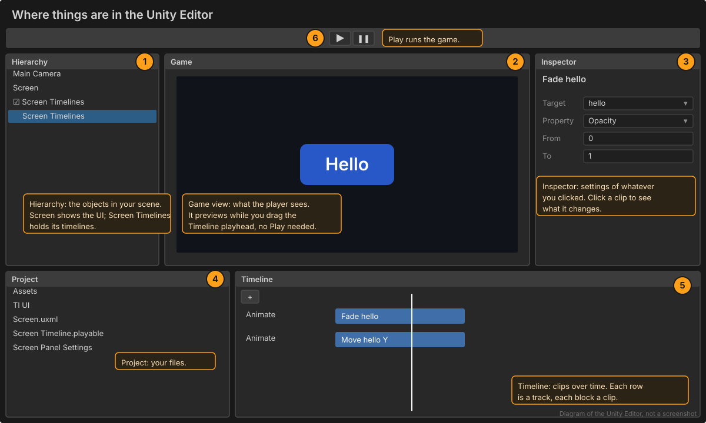

If a window is missing, reopen it from the **Window** menu:
- **Window > Sequencing > Timeline**
- **Window > UI Toolkit > UI Builder**
- **Window > General > Inspector, Hierarchy, Project, Game**

## 1. Make a screen

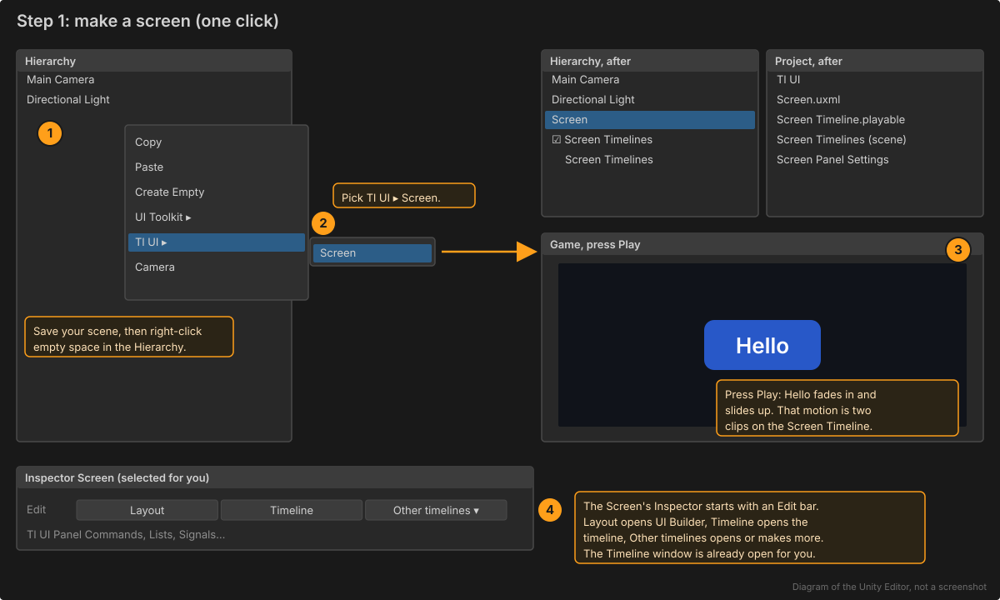

1. Save your scene (**File > Save**).
2. Right-click empty space in the **Hierarchy** and pick **Tl UI > Screen**.
3. Press **Play**.

Hello fades in and slides up:

| While it plays | When it has finished |
|---|---|
| 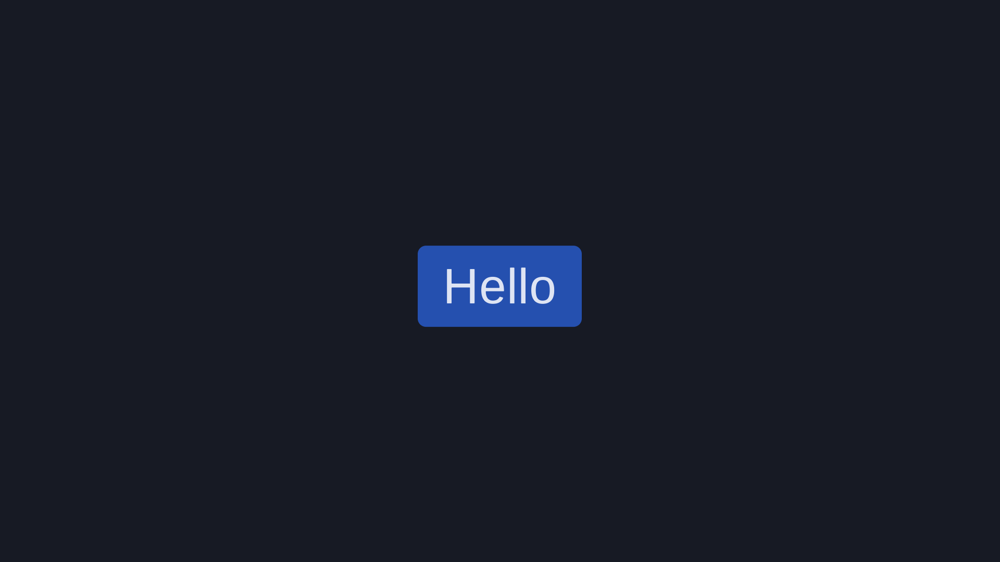 | 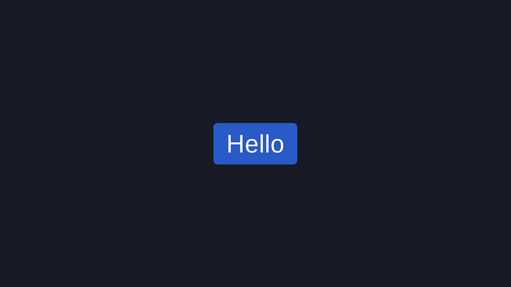 |

That motion is two clips, **Fade hello** and **Move hello Y**, on the screen's timeline. The next steps show where they are and how to make your own.

What the menu made, so you know what to open later:

| In | Name | What it is |
|---|---|---|
| Hierarchy | **Screen** | shows the UI. It has a Panel Renderer and a Tl UI Panel |
| Hierarchy | **Screen Timelines** | a SubScene that holds the object that plays the timelines |
| Project, `Assets/Tl UI` | `Screen.uxml` | the layout you edit in UI Builder |
| Project, `Assets/Tl UI` | `Screen Timeline.playable` | the timeline with the clips |

## 2. Lay out the screen in UI Builder

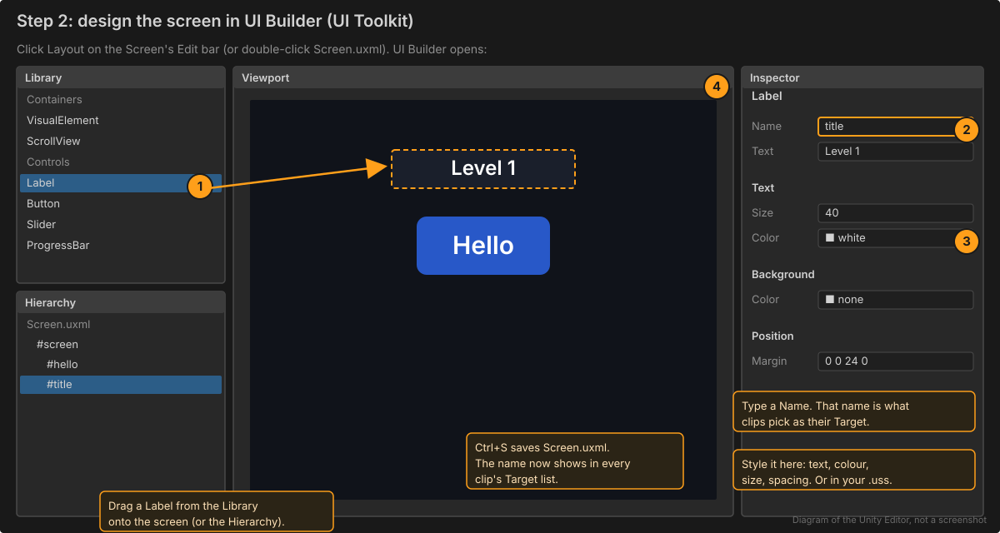

1. In the **Project** window, double-click `Assets/Tl UI/Screen.uxml`. UI Builder opens.
2. Drag an element from the **Library** onto the screen, or onto UI Builder's **Hierarchy**:
   - **Label**: text;
   - **Button**: something to click;
   - **VisualElement**: an empty box, for panels and groups;
   - **ProgressBar** and **Slider**: values.
3. Select it. In UI Builder's **Inspector**, type a **Name**, for example `title`. Clips find elements by this name.
4. Style it in the same Inspector: text, colour, size, background, spacing.
5. **Ctrl+S** to save.

Layout basics:
- Every box lays out its children in a column or a row: **Flex > Direction**.
- **Align** and **Justify** place the children.
- **Grow** makes a child take the space left.
- To reuse a look, give elements the same **class** (for example `card`) and style the class in a `.uss` stylesheet (UI Builder's StyleSheets panel), instead of styling each element.

## 3. Animate it in the Timeline

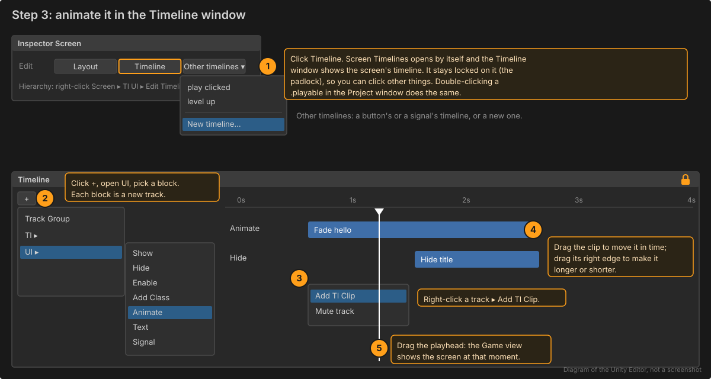

1. Open the timeline from its object, every time:
   - In the Hierarchy, tick the box next to **Screen Timelines**.
   - Expand it, and click the **Screen Timelines** object inside.
   - The Timeline window shows its timeline.

   Opened this way, the Inspector offers element names and the Game view previews while you scrub. Opened by double-clicking the `.playable`, it can't.
2. Click **+**, open **UI**, and pick a block. Each block is a track.
3. Right-click the track and pick **Add Tl Clip**.
4. Drag the clip to move it in time; drag its right edge to make it longer.
5. Drag the white playhead to see the screen at that moment. Press the Timeline's play button, or Play, to watch it run.

| Block | While the clip is on |
|---|---|
| **Show** / **Hide** | the target shows, or hides (Keep Space leaves its gap) |
| **Enable** / **Disable** | the target can be used, or is greyed out |
| **Add Class** / **Remove Class** | a USS class is added or removed, so your stylesheet decides the look |
| **Attach** | a small UXML template appears inside the target |
| **Animate** | one property goes From → To |
| **Text** | the target shows another text |
| **Signal** | fires once at the start: play another timeline, a sound, tell the game |
| **Focus** | keyboard and gamepad focus moves to the target |

## 4. Say what a clip changes

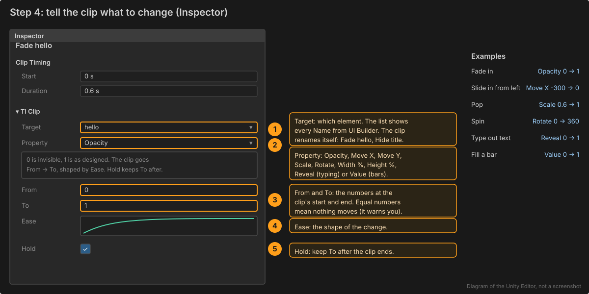

Click a clip. In the Inspector, under **Tl Clip**:

1. **Target**: pick the element by name. The clip renames itself, for example **Hide title**.
2. **Property** (Animate only): what changes. The grey box under it says what the numbers mean.
3. **From** and **To**: the value at the clip's start and end.
4. **Ease**: the shape of the change.
5. **Hold**: keep the To value after the clip ends. Unticked, the element goes back to how UI Builder made it.

When something is wrong, the Inspector says so:
- If From equals To, it warns that nothing moves.
- If the Target can't offer names, a blue note says how to open the timeline so it can.

## 5. Make buttons and lists do things

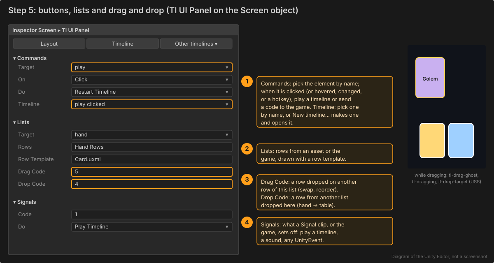

Select **Screen** in the Hierarchy. Its **Tl UI Panel** component has these tables:

- **Commands**: pick the element in **Target** by name. When it is clicked, hovered, changed, or a hotkey is pressed:
  - play, stop, pause or restart a timeline, by its slot;
  - or send a number (a code) to the game;
  - or run a UnityEvent.
- **Lists**: pick the container in **Target** by name. Rows come from an asset, or from the game, drawn with a row template (a small UXML).
  - **Drag Code**: a row dropped on another row of the same list (swap, reorder).
  - **Drop Code**: a row dropped here from another list (hand to table, bag to equipment).
- **Signals**: what a Signal clip, or the game, sets off.
- **Class Slots**, **Text Slots**, **Template Slots**: the names behind the Add Class, Text and Attach dropdowns. You can also add them from the clip's dropdown, with **New class name…** and **New text…**.

**Timeline slots.** Slot 0 is the timeline on the Screen Timelines object. Add more in that object's **Tl** section, under **Also Plays**. Their order there is slot 1, 2, and so on.

## Day-to-day recipes

Each recipe is clicks only.

**Fade a panel in when the screen opens**
1. On the screen's timeline: **+ > UI > Animate**, then **Add Tl Clip**.
2. Set the clip: **Target** your panel, **Property** Opacity, **From** 0, **To** 1, **Hold** ticked.

**Slide a menu in from the left**
- Animate with **Property** Move X, **From** -400, **To** 0, **Hold** ticked.
- Shape **Ease** fast-then-slow: in the curve editor, drag the left key's handle up.

**A button that pops when clicked**
1. Make a new timeline: **Project > right-click > Create > Timeline**, named `Pop`.
2. Add it to **Also Plays** on the Screen Timelines object. If it's first there, it is slot 1.
3. In `Pop`, add an Animate clip:
   - **Target**: the button;
   - **Property**: Scale, **From** 1, **To** 1.2;
   - **Ease**: a curve that goes up and back down;
   - **Hold**: unticked;
   - length: 0.2 s.
4. On **Screen > Tl UI Panel > Commands**, add a row: **Target** the button (a name list, like on clips), **On** Click, **Do** Play Timeline, **Timeline Slot** 1.

**Show "Level up!" for two seconds**
1. Add the label in UI Builder and hide it there (**Display: None**).
2. Add a **Show** clip, 2 s long.
3. Add an **Animate** Scale clip from 0.6 to 1 over the first 0.3 s.
4. Add an **Animate** Opacity clip from 1 to 0 over the last 0.3 s.

**Type out a line of dialogue**
1. Add a **Text** clip on the label. In **Text**, pick **New text…** and type the line.
2. Add an **Animate** clip on the same label: **Property** Reveal, **From** 0, **To** 1.

**Make something glow**
1. In your `.uss`, write a class: `.glow { scale: 1.1 1.1; transition-duration: 0.2s; }`.
2. Add an **Add Class** clip. In **Class**, pick **New class name…** and type `glow`.

**Swap whole screens (menu, settings)**
- Import the **Menu** sample: each screen is its own timeline, and buttons swap them, with no code.

## Cards

Import **Cards** from **Window > Package Manager > Tl Unity UI > Samples**, run **Tl UI > Samples > Build Cards**, open `Cards.unity` and press Play.

| Your hand | Dragging a card onto the table | Played: energy spent, score up |
|---|---|---|
| 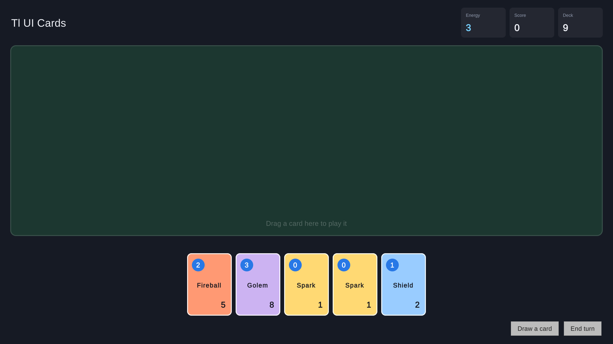 | 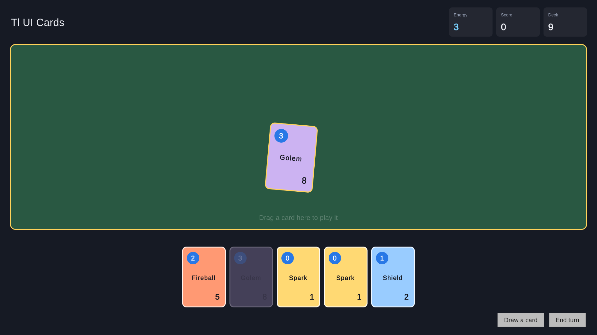 | 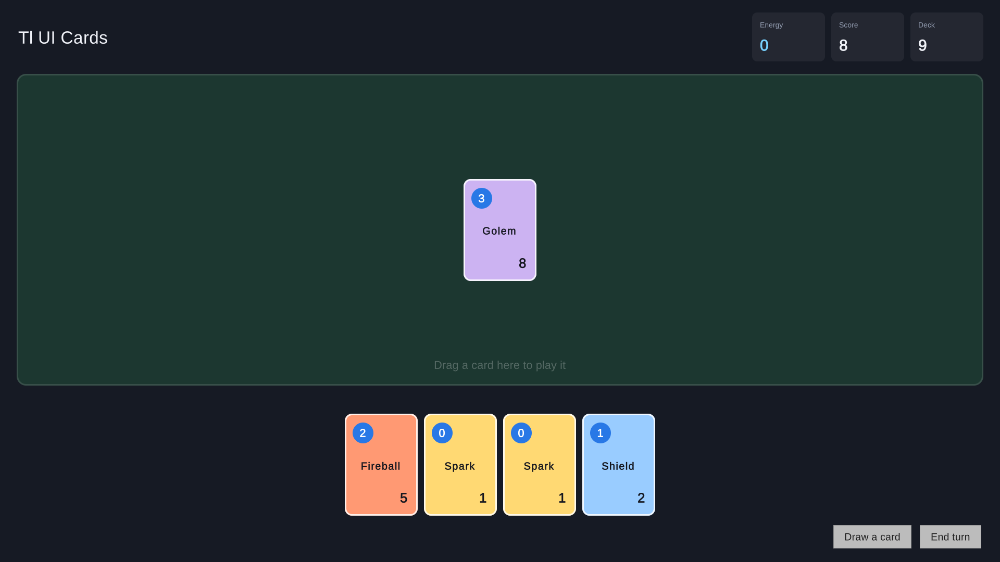 |

What you can try:
- Hover a card and it lifts.
- Drag it onto the table to play it.
- Drag it back to take it back, or drop it on another card in your hand to reorder.
- Play a card you can't afford, and the energy box shakes.
- **End turn** shows a banner.

| To change | Open | Change |
|---|---|---|
| the cards: name, cost, power, colour, copies | `Card Set.asset` | its Cards list in the Inspector |
| how cards look, lift and tilt | `Cards.uss` | `.card`, `.hand TemplateContainer:hover .card`, `.tl-drag-ghost .card` |
| the shake when energy runs out | `Cards Not Enough Energy.playable` | the Move energy X clip |
| the "Your turn" banner | `Cards New Turn.playable` | Show banner, Scale banner, Fade banner |
| the opening animation | `Cards Intro.playable` | Fade title, Move hand Y, Fade table |
| hand size, energy per turn, shuffle | **UI Sequence** in `Cards Objects` | the **Cards** component |

## Inventory

| The bag | Dragging the Sword onto Weapon | Equipped |
|---|---|---|
| 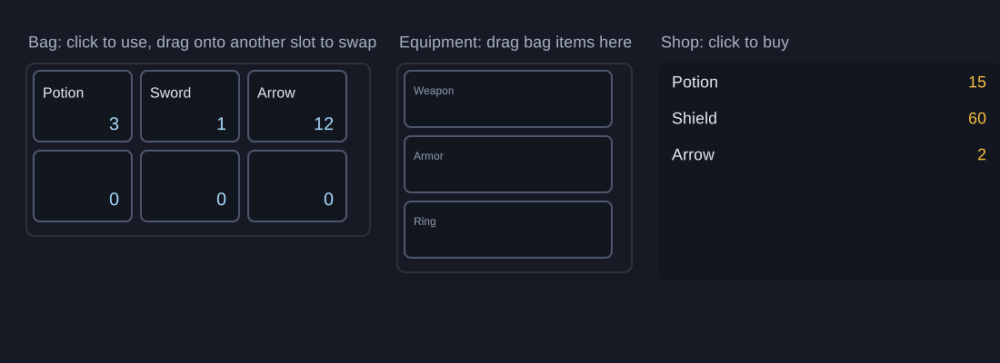 | 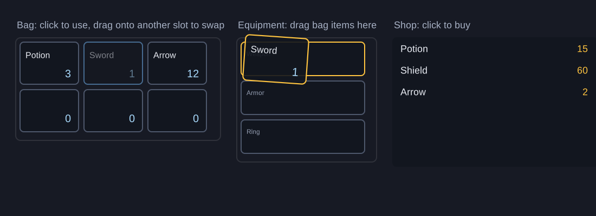 | 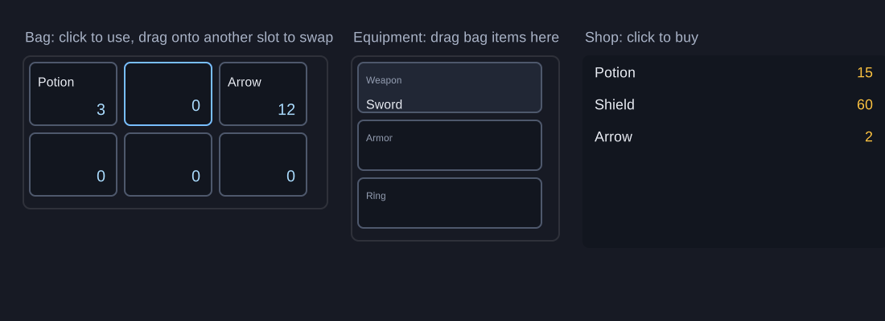 |

What you can try:
- Click a bag slot to use an item.
- Drag an item onto another slot to swap them.
- Drag it onto **Equipment** to equip it, and back onto the bag to unequip.
- Click a shop row to buy.

The rules (stacking, swapping, equipping) are a small Burst system. The things you change are the Bag component (starting items, equipment slots), `Inventory.uss`, and the row templates `BagSlot.uxml` and `EquipSlot.uxml`. In Play, the enemies also carry nameplates; the renders above show the UI alone.

## When something looks wrong

| You see | Do |
|---|---|
| "Target Id" and a blue note instead of names | on a clip: open the timeline from its object (step 3.1). On the Tl UI Panel: tick the box next to Screen Timelines in the Hierarchy |
| Target says "(no name: pick one)" | pick a name |
| The Inspector warns From and To are equal | set To |
| Nothing previews while scrubbing | open the timeline from its object, then drag the playhead |
| An Add Class clip changes nothing | style that class in your `.uss` |
| A clip does nothing at all | check that the track isn't muted (the speaker icon) and that the clip is inside the timeline |
